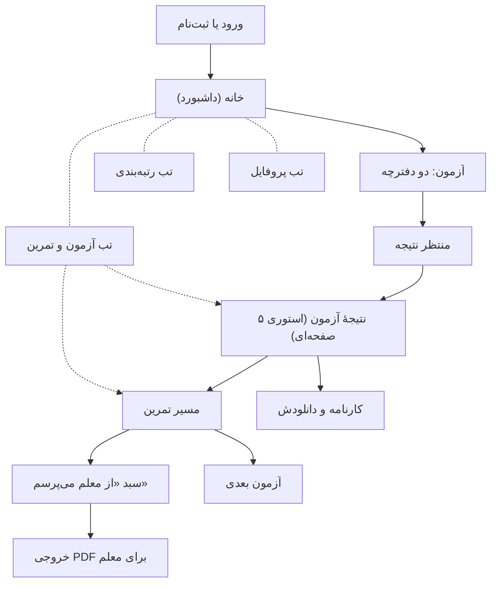
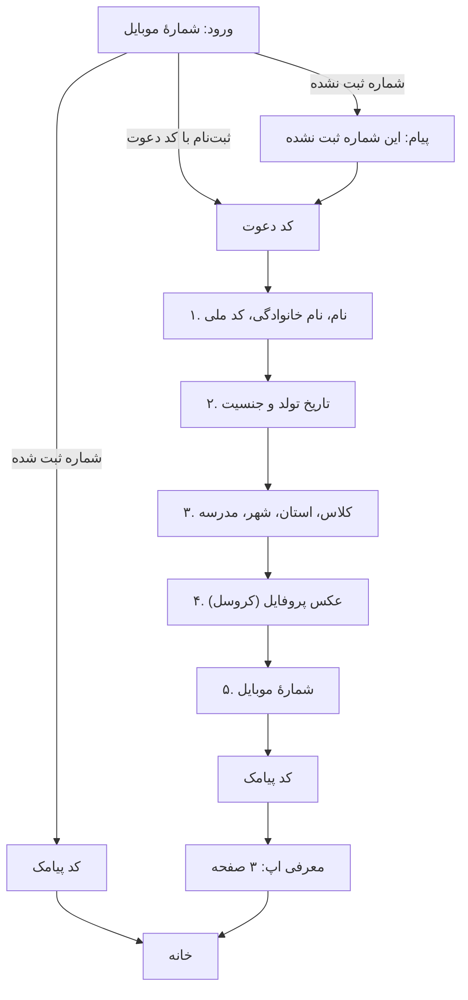
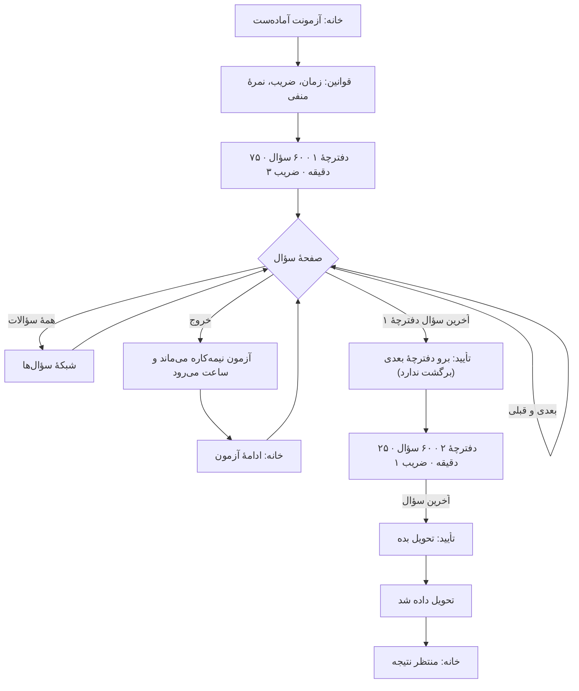
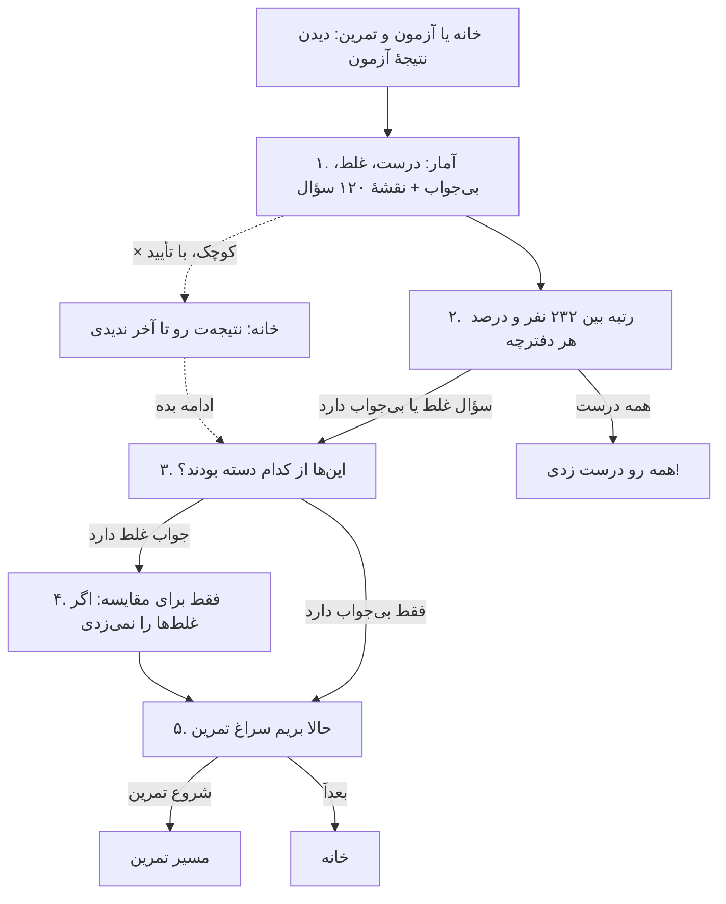
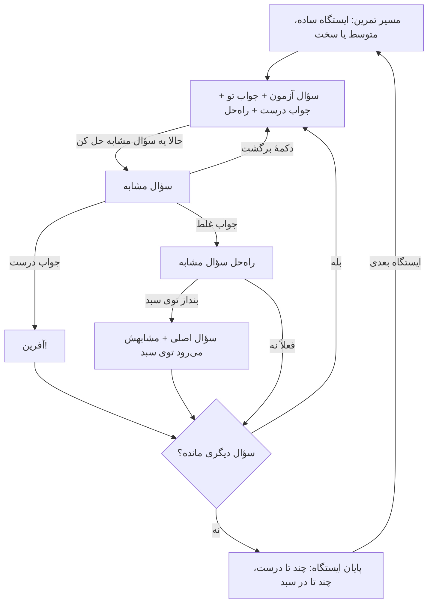
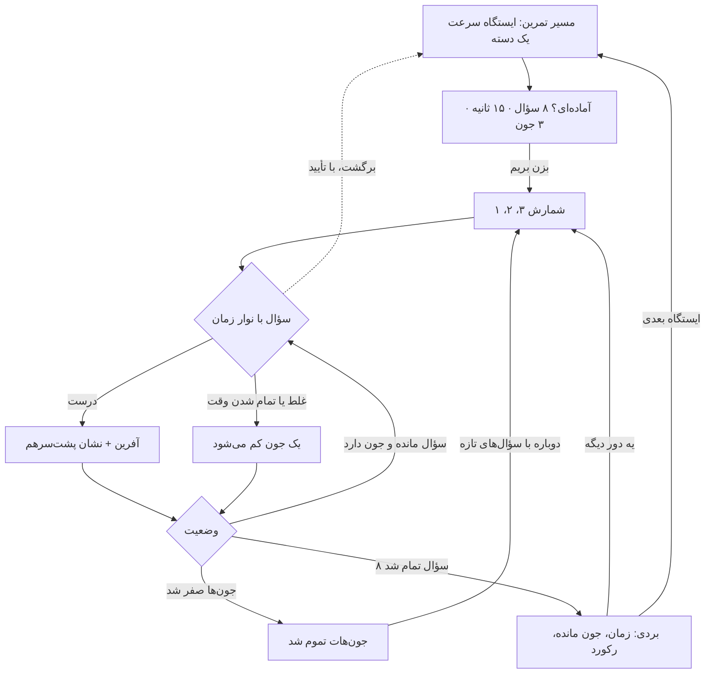
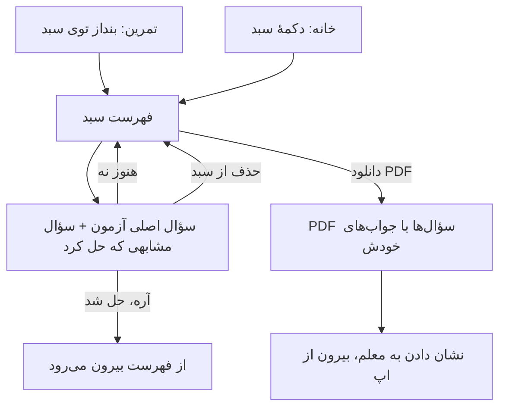

# فلوهای اپ آزمون

همهٔ مسیرهای اپ، با نقد هر مسیر. نمودارها با Mermaid نوشته شده‌اند و در GitHub نمایش داده می‌شوند.

## پنج پیشنهاد اول

1. **ثبت‌نام را کوتاه کن:** ۱۰ صفحه قبل از اولین تجربه زیاد است. شماره و کد پیامک اول، معرفی کوتاه‌تر، و روشن شدن اینکه فرم را والد پر می‌کند یا بچه.
2. **«پاک کردن جواب» را آشکار کن:** با نمرهٔ منفی این مهم‌ترین کار وسط آزمون است و الان پنهان است.
3. **حجم تمرین را مهار کن:** نوبت‌های ۵ سؤالی، شانس دوم قبل از سبد، و سقف برای سبد.
4. **نتیجه را برای دانش‌آموز ضعیف مهربان‌تر کن:** رتبهٔ خام برای نیمهٔ پایین جدول انگیزه نمی‌دهد.
5. **زمان انتظار نتیجه را پر کن:** الان بعد از تحویل آزمون اپ کاری برای بچه ندارد.

## نقشهٔ کلی اپ

از ورود تا آزمون بعدی. چهار تب پایین همیشه در دسترس‌اند؛ بقیه یک مسیر خطی است.

**خوب است**

- هر لحظه فقط یک کار اصلی جلوی بچه است: یا آزمون، یا نتیجه، یا تمرین.
- کل مسیر از خانه با یک دکمه ادامه پیدا می‌کند و هر جا نیمه‌کاره بماند، خانه «ادامه بده» نشان می‌دهد.

**خوب نیست**

- بین «تحویل آزمون» و «اعلام نتیجه» اپ هیچ کاری برای بچه ندارد.
- سبد در نوار پایین نیست و فقط از آیکون بالای خانه و داخل تمرین باز می‌شود.
- هیچ نقش والد یا معلمی در اپ نیست، با اینکه کارنامه و PDF برای آن‌ها ساخته می‌شود.

**پیشنهاد**

- در حالت «منتظر نتیجه» یک کار سبک بده: مثلاً یک دور بازی سرعت آزاد یا دیدن سؤال‌هایی که علامت زده بود.
- یک لینک اشتراک‌گذاری برای والد و معلم (کارنامه و سبد) در نظر بگیر.

## ورود و ثبت‌نام

کاربر قدیمی با شماره و کد پیامک وارد می‌شود. کاربر جدید کد دعوت می‌خواهد و فرم پنج‌مرحله‌ای را پر می‌کند.

**خوب است**

- فرم مرحله‌ای است و هر صفحه فقط یک موضوع دارد؛ خطاها می‌گویند چه چیزی غلط است.
- انتخاب عکس وسط فرم یک لحظهٔ سرگرم‌کننده بین فیلدهای خشک است.

**خوب نیست**

- از کد دعوت تا خانه ۱۰ صفحه است (کد دعوت، ۵ مرحله، کد پیامک، ۳ صفحهٔ معرفی). برای بچهٔ ۱۱ ساله زیاد است.
- کد ملی و شمارهٔ موبایل را خود بچه معمولاً ندارد یا بلد نیست؛ این فرم عملاً کار والد است ولی با لحن بچه نوشته شده.
- شمارهٔ موبایل آخر فرم است؛ اگر پیامک نرسد، همهٔ فرم پر شده و کاربر گیر می‌کند.

**پیشنهاد**

- شماره و کد پیامک را اول بگیر تا هم حساب ساخته شود و هم بقیهٔ فرم نیمه‌کاره ذخیره شود.
- معرفی سه‌صفحه‌ای را به یک صفحه برسان یا اختیاری کن.
- تصمیم بگیر فرم را والد پر می‌کند یا بچه، و لحن و ترتیب را با همان تنظیم کن.

## آزمون

دو دفترچهٔ ۶۰ سؤالی با ساعت جدا. بعد از رفتن به دفترچهٔ دوم، برگشتی به اولی نیست.

**خوب است**

- هدر ثابت با ساعت، پراگرس هر دفترچه و دکمهٔ «همهٔ سؤالات» همیشه جلوی چشم است.
- قبل از دو کار برگشت‌ناپذیر (رفتن به دفترچهٔ بعد و تحویل) تأیید می‌گیرد و تعداد بی‌جواب‌ها را می‌گوید.

**خوب نیست**

- با نمرهٔ منفی، «برداشتن جواب» مهم‌ترین کار است ولی فقط با دوباره زدن روی همان گزینه انجام می‌شود و هیچ نشانه‌ای ندارد.
- ۱۲۰ سؤال و ۱۰۰ دقیقه روی گوشی، بدون استراحت بین دو دفترچه.
- دفترچهٔ دوم ۶۰ سؤال در ۲۵ دقیقه است (۲۵ ثانیه برای هر سؤال) ولی صفحه‌اش با دفترچهٔ اول فرقی ندارد و حس سرعت نمی‌دهد.

**پیشنهاد**

- یک دکمهٔ کوچک «پاک کردن جواب» زیر گزینه‌ها بگذار، فقط وقتی گزینه‌ای انتخاب شده.
- بین دو دفترچه یک صفحهٔ نفس‌گیری بگذار که ساعتش نمی‌رود.
- در دفترچهٔ دوم بعد از انتخاب گزینه خودکار به سؤال بعد برو تا با زمان کم جور دربیاید.

## نتیجهٔ آزمون (استوری)

پنج صفحه با دکمهٔ برگشت. هر وقت بخواهد دوباره دیده می‌شود. اگر وسطش بیرون برود، خانه «ادامه بده» نشان می‌دهد.

**خوب است**

- اطلاعات کارنامه تکه‌تکه و با یک پیام در هر صفحه می‌آید، نه یک جدول شلوغ.
- صفحهٔ مقایسه یک درس عملی می‌دهد: «وقتی مطمئن نیستی، نزن».
- قصه مستقیم به تمرین وصل می‌شود و بن‌بست نیست.

**خوب نیست**

- صفحهٔ دوم فقط رتبه را بزرگ نشان می‌دهد. برای دانش‌آموز ضعیف (مثلاً نفر ۱۸۲ از ۲۳۲) این صفحه دلسردکننده است.
- صفحهٔ مقایسه برای کسی که غلط زیاد دارد عدد بزرگی نشان می‌دهد و ممکن است پیام «کمتر جواب بده» بگیرد، نه «بهتر یاد بگیر».
- نقشهٔ ۱۲۰ خانه‌ای در صفحهٔ اول ریز است و روی آن نمی‌شود زد.

**پیشنهاد**

- برای نیمهٔ پایین جدول، به‌جای رتبهٔ خام، نقاط قوت را جلو بیاور (بهترین دسته، سؤال سختی که درست زده).
- صفحهٔ مقایسه را فقط وقتی نشان بده که جابه‌جایی رتبه معنادار است.
- از آزمون دوم به بعد، مقایسه با آزمون قبلیِ خودش را اضافه کن.

## تمرین دفترچهٔ ۱: راه‌حل و سؤال مشابه

برای هر سؤال غلط یا بی‌جوابِ دفترچهٔ ۱. سه ایستگاه: ساده، متوسط، سخت.

**خوب است**

- ترتیب آموزشی درست است: اول ببین، بعد خودت حل کن، اگر نشد کمک بگیر.
- از ساده‌ها شروع می‌شود و موفقیت اول زود می‌رسد.
- انداختن در سبد یک حرکت دیدنی دارد و حس «گم نشد» می‌دهد.

**خوب نیست**

- حجم کنترل ندارد: دانش‌آموز متوسط حدود ۲۲ و ضعیف حدود ۴۰ سؤال در دفترچهٔ ۱ دارد و هر کدام دو صفحه است.
- بعد از جواب غلط به سؤال مشابه، شانس دومی نیست و تنها راه سبد یا رد شدن است.
- سبد می‌تواند ده‌ها سؤال بگیرد؛ هیچ معلمی وقت این‌همه را ندارد.

**پیشنهاد**

- تمرین را به نوبت‌های ۵ سؤالی بشکن و آخر هر نوبت یک جمع‌بندی کوچک بده.
- بعد از جواب غلط، یک سؤال مشابه دوم بده و فقط اگر آن هم غلط شد سبد را پیشنهاد کن.
- برای سبد سقف یا اولویت بگذار (مثلاً ۱۰ سؤال مهم‌تر بالا).

## تمرین دفترچهٔ ۲: مسیر سرعت

برای هر دسته‌ای که در دفترچهٔ ۲ غلط یا بی‌جواب داشته، یک ایستگاه بازی. سبد ندارد.

**خوب است**

- با ماهیت دفترچهٔ ۲ جور است: سؤال آسان، زمان کم.
- قانون‌ها قبل از شروع در سه عدد گفته می‌شوند و بازخورد هر جواب فوری است.
- باخت تنبیه سنگینی ندارد: سؤال تازه و شروع دوباره.

**خوب نیست**

- ۱۵ ثانیه برای همهٔ دسته‌ها یکی است؛ سؤال علوم دانستنی است و «سرعت» در آن معنا ندارد.
- دانش‌آموزی که در دفترچهٔ ۲ غلط ندارد، هیچ ایستگاه سرعتی نمی‌بیند، با اینکه بازی برای همه جذاب است.
- بعد از یک بار بردن، دلیلی برای برگشتن جز زدن رکورد خودش نیست.
- واحد پیشرفت دو جور است: در دفترچهٔ ۱ «سؤال» و در مسیر «ایستگاه».

**پیشنهاد**

- زمان هر سؤال را از روی دسته تنظیم کن و بعد از هر برد کمی کمترش کن.
- یک ایستگاه سرعت آزاد برای همه بگذار، حتی بدون غلط.
- رکورد هم‌کلاسی‌ها یا میانگین بقیه را کنار رکورد خودش نشان بده.

## سبد «از معلم می‌پرسم»

فقط سؤال‌های دفترچهٔ ۱ که در تمرین هم حل نشدند.

**خوب است**

- سؤال اصلی و سؤال مشابه به هم وصل‌اند، پس معلم می‌بیند بچه دقیقاً کجا گیر کرده.
- PDF پل واقعی به کلاس است و به هیچ امکانی در سمت معلم نیاز ندارد.

**خوب نیست**

- حلقه در اپ بسته نمی‌شود: «حل شد» فقط یک دکمه است و معلوم نیست واقعاً یاد گرفته یا نه.
- جواب درست در PDF نیست؛ معلم باید خودش حل کند.
- سبد پر یا خالی، هیچ اثری روی بقیهٔ اپ ندارد.

**پیشنهاد**

- بعد از «حل شد» یک سؤال مشابه تازه بده تا مطمئن شویم.
- در PDF یک نسخهٔ معلم با جواب درست و راه‌حل هم بساز.
- سبدِ خالی‌شده را در خانه جشن بگیر.
